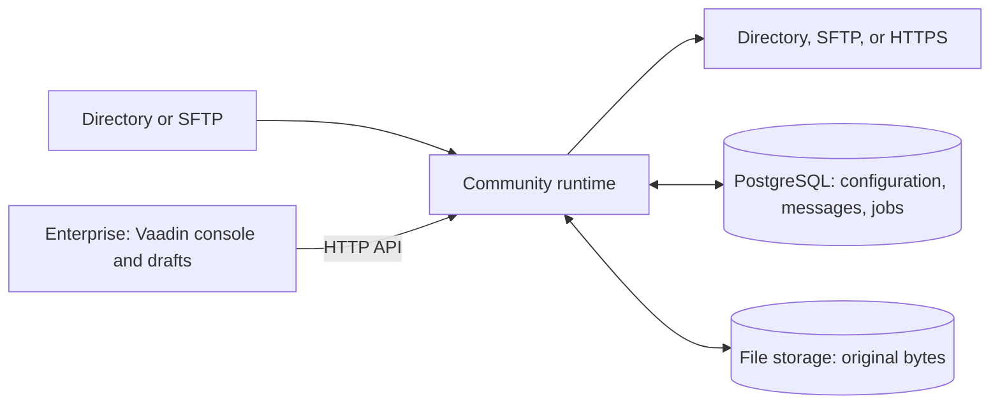

# M3 — Messaging Middleware

M3 receives files from directories and SFTP servers, keeps the original bytes, and routes each file to one or more destinations using published rules. Use it to archive inbound files, move files between systems, or hand them off to an HTTPS endpoint while keeping a record of each delivery attempt.

This repository contains **M3 Community v2**, the runtime that receives files and executes rules. **M3 Enterprise v2** adds the Vaadin console for editing, reviewing, and publishing configuration and for investigating messages and jobs. Community can run independently through its HTTP API. The current published pair is **2.0.0-rc.1**.

## Contents

- [What M3 does](#what-m3-does)
- [How it works](#how-it-works)
- [Quick start with Docker](#quick-start-with-docker)
- [Your first message flow](#your-first-message-flow)
- [Rules and processing](#rules-and-processing)
- [HTTP API](#http-api)
- [Configuration and access](#configuration-and-access)
- [Troubleshooting](#troubleshooting)
- [Development and tests](#development-and-tests)
- [Detailed documentation](#detailed-documentation)
- [Editions and versions](#editions-and-versions)

## What M3 does

| Capability | M3 v2 behavior |
| --- | --- |
| Receive files | Poll a local or mounted directory, or read from SFTP with server host-key verification. |
| Route and deliver | Match a source and optionally an exact filename, then deliver the original bytes to a directory, SFTP server, or HTTPS endpoint. |
| Preserve originals | Keep message metadata and delivery jobs in PostgreSQL and original bytes on disk. Verify an original against its recorded SHA-256. |
| Investigate delivery | Search jobs by status, source, or execution group. Inspect attempt history, retry an eligible job, or reprocess an original against the current configuration. |
| Monitor operations | Expose readiness and Prometheus metrics. Configure webhook and email notifications for operational events. |
| Edit visually | In Enterprise, build rules in the Vaadin editor, save drafts and diagram layouts, and review changes before publishing. |

## How it works

A **connection** describes the input location. A **source** uses that connection to receive files and selects which matching rules run. A **rule** connects sources to a **recipient** and assigns delivery to an execution group. Files are received once per source and content checksum while the corresponding message record exists.



Community runs ingestion and delivery in the same service. Enterprise stores its drafts, layouts, and audit records separately. A draft starts affecting live processing once it is published to Community. Community continues running the published version if Enterprise stops.

## Quick start with Docker

### Run Community and the Vaadin console

The [v2 Compose quick start](https://github.com/sysadminanywhere/m3.site/blob/main/README.md#быстрый-старт-m3-v2) provides a [Compose file](https://github.com/sysadminanywhere/m3.site/blob/main/compose.v2.yaml) and an [environment template](https://github.com/sysadminanywhere/m3.site/blob/main/.env.v2.example) for PostgreSQL, Community, and Enterprise. Download the raw files into one directory, copy `.env.v2.example` to `.env.v2`, and set the database password, administrator password, and persistent encryption key.

```powershell
docker compose --env-file .env.v2 -f compose.v2.yaml pull
docker compose --env-file .env.v2 -f compose.v2.yaml up -d
```

Open the Vaadin console at <http://127.0.0.1:8090/> and sign in with the administrator credentials from `.env.v2`. The supplied setup binds the console to the Docker host's loopback interface and keeps Community and PostgreSQL on the Compose network.

### Run Community from this repository

For a development instance, install JDK 21, Maven, and Docker with Compose. Run the following from this repository's root. The Dockerfile copies the packaged JAR, so build it before starting Compose.

```powershell
mvn clean package
docker compose up --build -d
Invoke-RestMethod http://localhost:8080/api/v2/health/ready
```

Use this Compose file on a trusted development machine. It publishes Community on port 8080 and PostgreSQL on port 5432 and uses local database credentials. For a shared installation, restrict network access, supply private credentials, and use the security settings below.

`docker compose down` stops the source setup and preserves its named volumes. `docker compose down --volumes` deletes the database and stored originals. Back up both [before replacing or upgrading an installation](docs/operations/backup-and-restore.md), especially if an older v2 Compose file used anonymous volumes or container-local storage.

## Your first message flow

On a **fresh** Community instance started from this repository, publish the [sample configuration](docs/v2/configuration.example.json). It watches `/data/in` in the container and delivers `daily.txt` to `/data/archive`. These paths use the same named volume as the running container's `/data` mount.

```powershell
$api = 'http://localhost:8080/api/v2'
$headers = @{}
if ($env:M3_API_TOKEN) { $headers['X-M3-Service-Token'] = $env:M3_API_TOKEN }
$document = Get-Content -LiteralPath docs/v2/configuration.example.json -Raw | ConvertFrom-Json
$request = @{ expectedVersion = 0; document = $document } | ConvertTo-Json -Depth 20

docker compose exec -T community mkdir -p /data/in /data/archive
Invoke-RestMethod "$api/configuration/publish" -Method Post -Headers $headers -ContentType application/json -Body $request
docker compose exec -T community sh -c 'echo "hello from M3" > /data/.daily.txt && mv /data/.daily.txt /data/in/daily.txt'
```

After a few seconds, check the delivery job and read the archived file. Community prefixes the destination filename with the job ID.

```powershell
$jobs = Invoke-RestMethod "$api/jobs" -Headers $headers
$job = $jobs | Where-Object { $_.ruleId -eq 'archive-all' -and $_.status -eq 'DELIVERED' } | Select-Object -First 1
if (!$job) { throw 'Delivery has not finished. Check again after a few seconds.' }
$job | Select-Object id, status, attempts
docker compose exec -T community cat "/data/archive/$($job.id)-daily.txt"
```

An existing installation returns HTTP 409 for the example's `expectedVersion = 0`. Review its published configuration before submitting any changes. In Enterprise, create the equivalent source, rule, and recipient in a draft, review validation messages, and publish it from the Vaadin console.

## Rules and processing

- A source can run all matching enabled rules (`ALL_MATCHING`) or only the first one in configuration order (`FIRST_MATCHING`).
- Rules run in parallel by default. Sequential processing allows one active job per rule in its execution group. The rule can stop or continue after an error.
- Each job keeps its rule version and execution group. Retrying an existing job uses that version. Reprocessing an original applies the currently published configuration and creates new jobs.
- Directory sources wait for file size and modification time to stabilize. Place a complete file in the input directory by atomically renaming it into place. Community leaves input files in place.
- Delivery is at-least-once. If the destination may already have accepted a file, inspect the destination before retrying an `UNCERTAIN` job.

See [rule selection, retries, deduplication, and bootstrap configuration](docs/v2/rule-processing.md) for the detailed behavior.

## HTTP API

| Task | Endpoint |
| --- | --- |
| Check the process and database | `GET /api/v2/health/live`, `GET /api/v2/health/ready` |
| Read the active configuration | `GET /api/v2/configuration/current` |
| Validate or publish configuration | `POST /api/v2/configuration/validate`, `POST /api/v2/configuration/publish` |
| Search jobs and inspect attempts | `GET /api/v2/jobs/search`, `GET /api/v2/jobs/{id}/history` |
| Retrieve or verify an original | `GET /api/v2/messages/{id}/original`, `GET /api/v2/messages/{id}/integrity` |
| Retry or reprocess | `POST /api/v2/jobs/{id}/retry`, `POST /api/v2/messages/{id}/reprocess` |
| Scrape operational metrics | `GET /api/v2/metrics/prometheus` |

See the [OpenAPI contract](docs/v2/api-contract.yaml) for request and response formats. When you configure `M3_API_TOKEN`, send it in the `X-M3-Service-Token` header for non-health API calls.

## Configuration and access

| Setting | Purpose |
| --- | --- |
| `DB_URL`, `DB_USER`, `DB_PASSWORD` | PostgreSQL connection and credentials. |
| `M3_STORAGE_ROOT` | Original-file storage. All Community replicas of the same installation need access to the same files at the same path. |
| `M3_EXECUTION_GROUP` | Group whose jobs this worker can claim. Defaults to `default`. |
| `M3_SECRET_KEY`, `M3_SECRET_KEY_FILE` | Persistent Base64-encoded 32-byte encryption key, supplied directly or through a file. The direct variable takes precedence. |
| `M3_API_TOKEN` | Service token for Community API calls. Enterprise supplies the same value through `COMMUNITY_SERVICE_TOKEN`. |
| `M3_VAULT_ADDR`, `M3_VAULT_TOKEN_FILE` | Optional read-only HashiCorp Vault KV v2 integration for SFTP credentials. |

Keep the encryption key outside Git and back it up separately. Community stores encrypted secret values in PostgreSQL and returns metadata through the secrets API. For a shared installation, enable Enterprise authentication, protect both HTTP connections with trusted HTTPS, and restrict Community API access with the service token.

## Troubleshooting

| Symptom | Check |
| --- | --- |
| Community readiness returns 503 | Check whether PostgreSQL is reachable and inspect `docker compose logs --tail 100 community`. |
| A source has no delivery jobs | Check the published configuration, the source path inside the container, file stability, the filename condition, and source-level deduplication. |
| Jobs remain queued | Check that a running Community worker uses the job's execution group and that earlier failures are not blocking a sequential rule. |
| The API returns 401 | Check the `X-M3-Service-Token` header and the configured Community token. |
| A job is `UNCERTAIN` | Verify the destination and review job history before requesting a retry. |
| Original bytes cannot be retrieved | Check the original-file storage mount and verify the message with the integrity endpoint. Use the documented restore procedure if needed. |

## Development and tests

Community uses Java 21 and Maven. Run unit tests and build the JAR from the repository root.

```powershell
mvn test
mvn package
```

For IntelliJ IDEA, import the root `pom.xml` as a Maven project, select JDK 21, and start PostgreSQL with `docker compose up -d postgres`. Run the Community Spring Boot application from IDEA. It uses the default development database on `localhost:5432` and listens on `localhost:8080`.

PostgreSQL integration tests are opt-in through `M3_TEST_POSTGRES_URL`. Use an isolated PostgreSQL server with an `m3test`/`m3test` role granted `CREATEDB`. Tests create and remove randomly named databases from `template0`. The full-storage test also requires a dedicated small tmpfs set by `M3_TEST_INGEST_TMPFS`.

## Detailed documentation

- [OpenAPI contract](docs/v2/api-contract.yaml), [example configuration](docs/v2/configuration.example.json), and [rule processing](docs/v2/rule-processing.md)
- [SFTP and Vault](docs/SFTP.md) and [HTTPS recipients](docs/HTTP_DELIVERY.md)
- [Webhook and email notifications](docs/WEBHOOK_NOTIFICATIONS.md), [Prometheus](docs/PROMETHEUS.md), and [Grafana dashboard](docs/monitoring/m3-community-dashboard.json)
- [Backup and restore](docs/operations/backup-and-restore.md), [retention](docs/operations/retention.md), and [performance baseline](docs/performance-baseline.md)
- [Kubernetes deployment template](deploy/kubernetes/README.md)

## Editions and versions

**Community v2** owns the published configuration, ingestion, delivery, and original messages. **Enterprise v2** provides the Vaadin editor and the operations console. The public `2.0.0-rc.1` images are [Community](https://hub.docker.com/r/sysadminanywhere/m3/tags?name=2.0.0-rc.1) and [Enterprise](https://hub.docker.com/r/sysadminanywhere/m3-enterprise/tags?name=2.0.0-rc.1). Use matching v2 tags when running them together.

For a v1 installation, use the [archived v1 README](https://github.com/sysadminanywhere/m3/blob/4633144a8a232a6a42901beb3471da71d087acfc/README.md). Start v2 with fresh PostgreSQL and original-file volumes. This release does not migrate v1 data or configuration in place.
